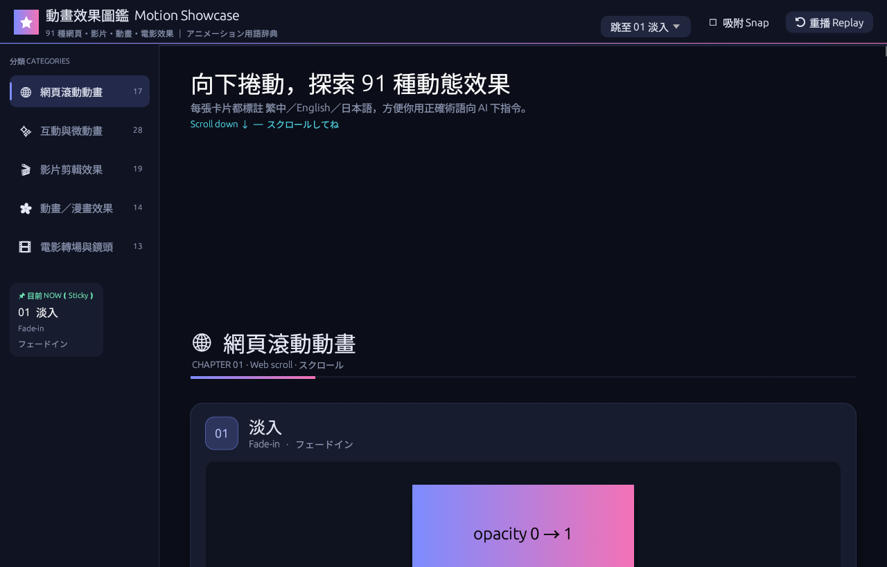
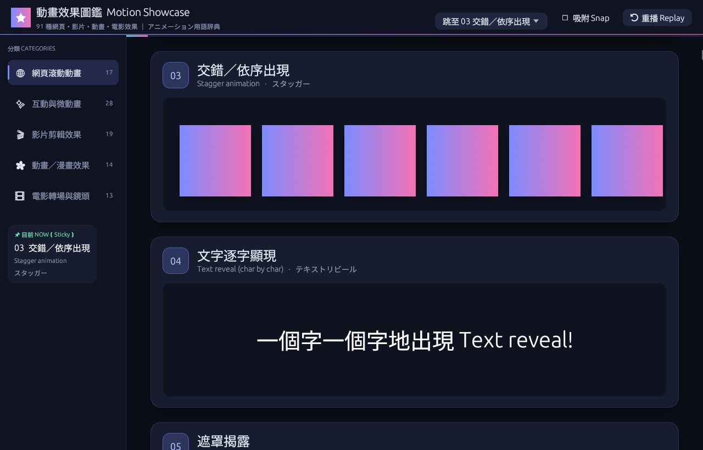
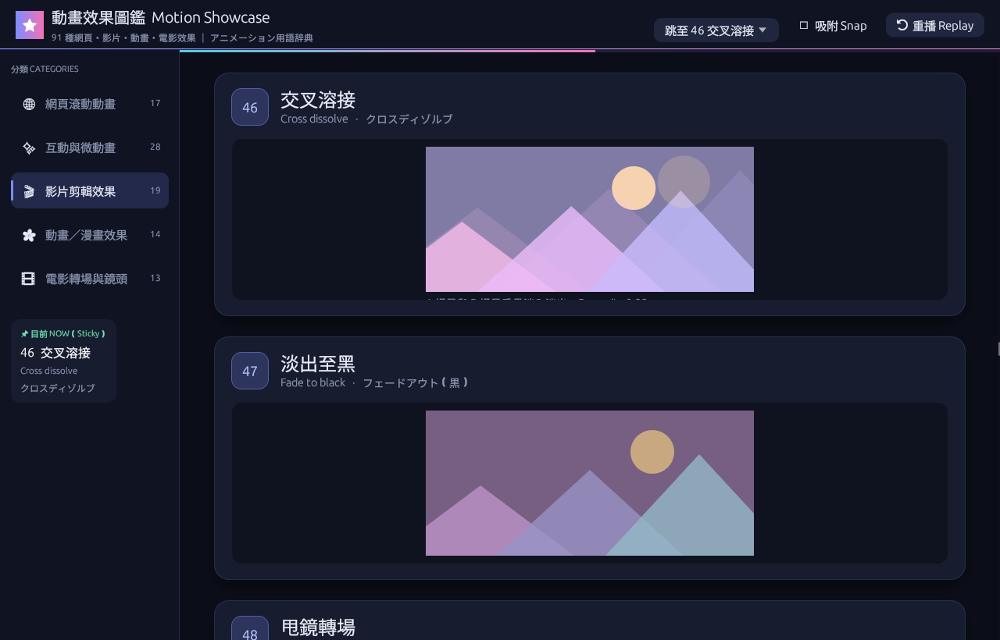
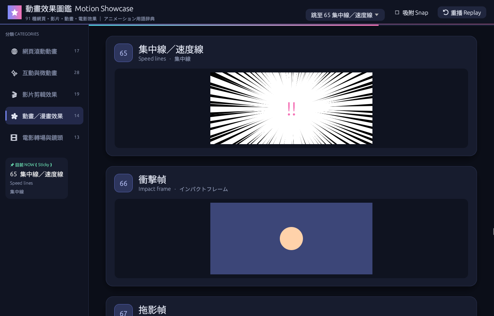
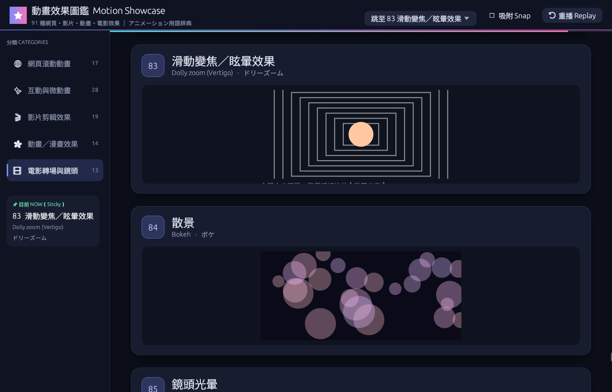

# Anime Showcase 動態效果圖鑑 (anime-showcase)

用 Rust + eframe/egui 做的桌面程式，把常見的「流行網頁滾動動畫」以及影片剪輯、動畫（アニメ）、電影常見特效一個一個示範出來，並標上**日文／英文／繁體中文**名稱，方便你用正確的術語向 AI 下指令。

## 執行
```bash
cargo run --release
```
往下捲動，區塊進入畫面時會播放動畫（離開畫面再回來會重播）；部分效果（視差、縮放、文字填色、橫向捲動、Sticky 等）跟著捲動位置變化。上方「Replay 重播」可全部重播，「Scroll snap」可開啟吸附，「跳至」下拉選單可直接跳到任一效果；懸停類效果請把滑鼠移上去（帶慣性跟隨）。

直接開到指定編號：
```bash
cargo run --release -- --goto 46   # 從 46 交叉溶接開始
```

## 動畫術語一覽（共 91 種，分 5 類）

### 🌐 網頁滾動動畫 Web scroll
| # | 繁體中文 | English | 日本語 |
|---|---|---|---|
| 01 | 淡入 | Fade-in | フェードイン |
| 02 | 滑入 | Slide-in | スライドイン |
| 03 | 交錯／依序出現 | Stagger animation | スタッガー |
| 04 | 文字逐字顯現 | Text reveal (char by char) | テキストリビール |
| 05 | 遮罩揭露 | Mask / Clip-path reveal | マスクリビール |
| 06 | 模糊淡入 | Blur-in | ブラーイン |
| 07 | 數字跳動 | Count-up numbers | カウントアップ |
| 08 | 進度條填充 | Progress bar fill | プログレスバー |
| 09 | 滾動連動 | Scroll-linked animation | スクロール連動 |
| 10 | 視差滾動 | Parallax | パララックス |
| 11 | 滾動縮放 | Scale on scroll | スクロールズーム |
| 12 | 圖片序列 | Image sequence (scrub) | 画像シーケンス |
| 13 | SVG 描線 | SVG line draw | SVGラインドロー |
| 14 | 滾動文字填色 | Text fill on scroll | テキストフィル |
| 15 | 固定／釘選 | Sticky / Pinning | スティッキー |
| 16 | 滾動吸附 | Scroll snap | スクロールスナップ |
| 17 | 跑馬燈／無限循環 | Marquee / Infinite loop | マーキー |

### ✨ 網頁互動／微動畫 UI micro-interactions
| # | 繁體中文 | English | 日本語 |
|---|---|---|---|
| 18 | 放大進場 | Zoom-in | ズームイン |
| 19 | 翻轉／旋轉進場 | Flip / Rotate-in | フリップイン |
| 20 | 彈跳 | Bounce | バウンス |
| 21 | 彈性／彈簧 | Elastic / Spring | スプリング |
| 22 | 打字機效果 | Typewriter | タイプライター |
| 23 | 文字亂碼解碼 | Text scramble / Shuffle | テキストスクランブル |
| 24 | 漸層文字流光 | Gradient text shimmer | グラデーションシマー |
| 25 | 拆字波浪 | Split-text wave | スプリットテキストウェーブ |
| 26 | 懸停浮起／3D 傾斜 | Hover lift / 3D tilt | 3Dチルト |
| 27 | 磁吸按鈕 | Magnetic button | マグネティックボタン |
| 28 | 水波紋 | Ripple | リップル |
| 29 | 形狀變形 | Shape morphing | モーフィング |
| 30 | 橫向捲動區塊 | Horizontal scroll section | 横スクロール |
| 31 | 布幕／擦除轉場 | Curtain / Wipe transition | カーテン／ワイプ |
| 32 | 骨架屏流光 | Skeleton shimmer | スケルトンシマー |
| 33 | 載入轉圈 | Loading spinners | ローディングスピナー |
| 34 | 粒子爆發 | Particle burst | パーティクルバースト |
| 35 | 故障雜訊 | Glitch | グリッチ |
| 36 | 脈動 | Pulse | パルス |
| 37 | 搖晃 | Shake | シェイク |
| 38 | 手風琴展開 | Accordion expand | アコーディオン |
| 39 | 卡片翻面 | Card flip | カードフリップ |
| 40 | 環形進度 | Progress ring | プログレスリング |
| 41 | 雙向跑馬燈 | Bi-directional marquee | 双方向マーキー |
| 42 | 游標跟隨 | Cursor follower | カーソルフォロワー |
| 43 | 捲動速度傾斜 | Scroll velocity skew | スクロール速度スキュー |
| 44 | 懸停顯示圖片 | Reveal-on-hover image | ホバー画像リビール |
| 45 | 交錯網格 | Staggered grid | スタッガーグリッド |

### 🎬 影片剪輯效果 Video editing
| # | 繁體中文 | English | 日本語 |
|---|---|---|---|
| 46 | 交叉溶接 | Cross dissolve | クロスディゾルブ |
| 47 | 淡出至黑 | Fade to black | フェードアウト（黒） |
| 48 | 甩鏡轉場 | Whip pan | ウィップパン |
| 49 | 縮放轉場 | Zoom transition | ズームトランジション |
| 50 | 肯·伯恩斯效果 | Ken Burns effect | ケン・バーンズ |
| 51 | 慢動作／變速 | Slow motion / Speed ramp | スピードランプ |
| 52 | 定格畫面 | Freeze frame | フリーズフレーム |
| 53 | 分割畫面 | Split screen | 分割画面 |
| 54 | 子母畫面 | Picture-in-picture | ピクチャーインピクチャー |
| 55 | 漏光 | Light leak | ライトリーク |
| 56 | 底片顆粒 | Film grain | フィルムグレイン |
| 57 | 暗角 | Vignette | ビネット |
| 58 | 色差 | Chromatic aberration | 色収差 |
| 59 | RGB 分離 | RGB split | RGBスプリット |
| 60 | 電影黑邊 | Letterbox | レターボックス |
| 61 | 調色／LUT | Color grading / LUT | カラーグレーディング |
| 62 | 下方字幕條 | Lower third | ロワーサード |
| 63 | 動態文字排版 | Kinetic typography | キネティックタイポグラフィ |
| 64 | 匹配剪輯 | Match cut | マッチカット |

### 🌸 動畫／漫畫效果 Anime
| # | 繁體中文 | English | 日本語 |
|---|---|---|---|
| 65 | 集中線／速度線 | Speed lines | 集中線 |
| 66 | 衝擊幀 | Impact frame | インパクトフレーム |
| 67 | 拖影幀 | Smear frame | スメアフレーム |
| 68 | 畫面震動 | Screen shake | 画面揺れ |
| 69 | 櫻花飄落 | Sakura particles | 桜吹雪 |
| 70 | Q版彈出 | Chibi pop | ちびポップ |
| 71 | 汗滴 | Sweat drop | 汗マーク |
| 72 | 怒氣符號 | Anger mark | 怒りマーク |
| 73 | 閃亮光芒 | Kira sparkle | キラキラ |
| 74 | 閃白 | Flash / White-out | ホワイトアウト |
| 75 | 漫畫分格 | Manga panel frame | 漫画コマ |
| 76 | 傾斜鏡頭 | Dutch angle | ダッチアングル |
| 77 | 背景平移 | Background pan | 背景パン |
| 78 | 過場卡 | Eyecatch | アイキャッチ |

### 🎞 電影轉場與鏡頭 Film
| # | 繁體中文 | English | 日本語 |
|---|---|---|---|
| 79 | 圓形擦除 | Iris wipe | アイリスワイプ |
| 80 | 星形擦除 | Star wipe | スターワイプ |
| 81 | 時鐘擦除 | Clock wipe | クロックワイプ |
| 82 | 移焦 | Rack focus | ラックフォーカス |
| 83 | 滑動變焦／眩暈效果 | Dolly zoom (Vertigo) | ドリーズーム |
| 84 | 散景 | Bokeh | ボケ |
| 85 | 鏡頭光暈 | Lens flare | レンズフレア |
| 86 | 下雨疊加 | Rain overlay | 雨オーバーレイ |
| 87 | CRT／錄影帶效果 | CRT / VHS | CRT／VHS |
| 88 | 膠片故障 | Film glitch / burn | フィルムグリッチ |
| 89 | 片尾字幕捲動 | Title credits roll | エンドロール |
| 90 | 倒數片頭 | Countdown leader | カウントダウンリーダー |
| 91 | 老電影閃爍刮痕 | Old film flicker / scratches | 古いフィルムのちらつき |

## 截圖







## 介面
深色海軍藍主題、圓角卡片與柔和陰影、左側分類導覽（點擊跳轉）、頂部漸層進度條、編號徽章與中／英／日標題。

## 限制
這是原生桌面程式，用 egui 模擬網頁效果：模糊、3D 傾斜、圖片序列、SVG 描線、景深、鏡頭光暈、CRT 等都是近似畫法，並不是真正的 CSS/SVG。

## 動態（motion）檢查
v0.2.0 逐一檢查 91 個效果是否真的「用動態表現」，修正如下：

| # | 效果 | 原狀況 | 改善 |
|---|---|---|---|
| 15 | Sticky | 只有一行說明文字，卡片內不會動 | 內容列隨捲動上移，標題列釘在頂端 |
| 16 | Scroll snap | 只有說明文字 | 無限輪播：拖曳後放手，彈簧回彈對齊最近的卡片 |
| 26 | 3D tilt | 滑鼠進出時瞬間跳變 | 平滑跟隨游標，依距離漸強漸弱 |
| 27 | Magnetic button | 超過 220px 時瞬間彈回 | 平滑跟隨，依距離連續衰減 |
| 29 | Shape morphing | 只在圓與方之間切換 | ● → ■ → ★ 三段變形，以 mesh 填色（凹形不會破圖） |
| 42 | Cursor follower | 圓圈與游標同步，沒有「跟隨」感 | 圓圈延遲追趕真實游標 |
| 43 | Scroll velocity skew | 速度只取單一幀，抖動 | 捲動速度平滑化後再傾斜 |
| 44 | Reveal-on-hover | 圖片硬貼在游標旁 | 圖片帶慣性滑行跟隨 |
| 46 | Cross dissolve | 實作成單色蓋上去，不是溶接 | A、B 兩場景真正以透明度交疊，並各自緩慢平移 |
| 51 | Speed ramp | 每幀跑 200 次迴圈 | 改用公式計算位置，加速度殘影 |
| 53 | Split screen | 完全靜止 | 左右畫面滑入，各自持續平移 |
| 63 | Kinetic typography | 計算了旋轉角度但沒套用 | 文字依節拍放大＋旋轉 |
| 80/81/90 | 星形／時鐘擦除、倒數片頭 | 多個三角形拼接，邊緣有縫 | 改為單一 mesh |

其他：
- 畫面外的區塊不再繪製（91 個區塊原本每幀全畫）。
- 系統為淺色主題時背景會變白 → 固定深色主題。
- 清除未使用的程式碼；`cargo clippy` 零警告。

## 變更歷史
| 版本 | 日期 | 內容 | 影響範圍 |
|---|---|---|---|
| v0.2.0 | 2026-10-12 | 專案改名 anime-showcase；動態檢查與 13 項效果改善；章節跳轉選單與 `--goto`；離開畫面再回來重播；畫面外不繪製；固定深色主題 | src/main.rs, Cargo.toml, README.md |
| v0.1.0 | — | 91 種效果初版 | — |
