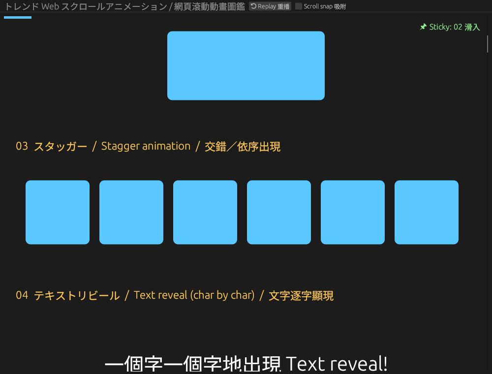
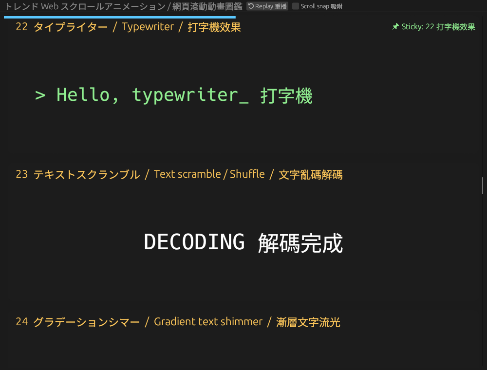

# Rust 網頁滾動動畫圖鑑 (anim-showcase)

用 Rust + eframe/egui 做的桌面程式，把常見的「流行網頁滾動動畫」一個一個示範出來，並標上**日文／英文／繁體中文**名稱，方便你用正確的術語向 AI 下指令。

## 執行
```bash
cargo run --release
```
往下捲動，區塊進入畫面時會播放動畫；部分效果（視差、縮放、文字填色、橫向捲動等）跟著捲動位置變化。上方「Replay 重播」可重播，「Scroll snap」可開啟吸附；懸停類效果請把滑鼠移上去。

## 動畫術語一覽
| # | 繁體中文 | English | 日本語 |
|---|---|---|---|
| 01 | 淡入 | Fade-in | フェードイン |
| 02 | 滑入 | Slide-in | スライドイン |
| 03 | 交錯／依序出現 | Stagger animation | スタッガー |
| 04 | 文字逐字顯現 | Text reveal (char by char) | テキストリビール |
| 05 | 遮罩揭露 | Mask / Clip-path reveal | マスクリビール |
| 06 | 模糊淡入 | Blur-in | ブラーイン |
| 07 | 數字跳動 | Count-up numbers | カウントアップ |
| 08 | 進度條填充 | Progress bar fill | プログレスバー |
| 09 | 滾動連動 | Scroll-linked animation | スクロール連動 |
| 10 | 視差滾動 | Parallax | パララックス |
| 11 | 滾動縮放 | Scale on scroll | スクロールズーム |
| 12 | 圖片序列 | Image sequence (scrub) | 画像シーケンス |
| 13 | SVG 描線 | SVG line draw | SVGラインドロー |
| 14 | 滾動文字填色 | Text fill on scroll | テキストフィル |
| 15 | 固定／釘選 | Sticky / Pinning | スティッキー |
| 16 | 滾動吸附 | Scroll snap | スクロールスナップ |
| 17 | 跑馬燈／無限循環 | Marquee / Infinite loop | マーキー |
| 18 | 放大進場 | Zoom-in | ズームイン |
| 19 | 翻轉／旋轉進場 | Flip / Rotate-in | フリップイン |
| 20 | 彈跳 | Bounce | バウンス |
| 21 | 彈性／彈簧 | Elastic / Spring | スプリング |
| 22 | 打字機效果 | Typewriter | タイプライター |
| 23 | 文字亂碼解碼 | Text scramble / Shuffle | テキストスクランブル |
| 24 | 漸層文字流光 | Gradient text shimmer | グラデーションシマー |
| 25 | 拆字波浪 | Split-text wave | スプリットテキストウェーブ |
| 26 | 懸停浮起／3D 傾斜 | Hover lift / 3D tilt | 3Dチルト |
| 27 | 磁吸按鈕 | Magnetic button | マグネティックボタン |
| 28 | 水波紋 | Ripple | リップル |
| 29 | 形狀變形 | Shape morphing | モーフィング |
| 30 | 橫向捲動區塊 | Horizontal scroll section | 横スクロール |
| 31 | 布幕／擦除轉場 | Curtain / Wipe transition | カーテン／ワイプ |
| 32 | 骨架屏流光 | Skeleton shimmer | スケルトンシマー |
| 33 | 載入轉圈 | Loading spinners | ローディングスピナー |
| 34 | 粒子爆發 | Particle burst | パーティクルバースト |
| 35 | 故障雜訊 | Glitch | グリッチ |
| 36 | 脈動 | Pulse | パルス |
| 37 | 搖晃 | Shake | シェイク |
| 38 | 手風琴展開 | Accordion expand | アコーディオン |
| 39 | 卡片翻面 | Card flip | カードフリップ |
| 40 | 環形進度 | Progress ring | プログレスリング |
| 41 | 雙向跑馬燈 | Bi-directional marquee | 双方向マーキー |
| 42 | 游標跟隨 | Cursor follower | カーソルフォロワー |
| 43 | 捲動速度傾斜 | Scroll velocity skew | スクロール速度スキュー |
| 44 | 懸停顯示圖片 | Reveal-on-hover image | ホバー画像リビール |
| 45 | 交錯網格 | Staggered grid | スタッガーグリッド |




## 限制
這是原生桌面程式，用 egui 模擬網頁效果：模糊、3D 傾斜、圖片序列、SVG 描線等都是近似畫法，並不是真正的 CSS/SVG。
